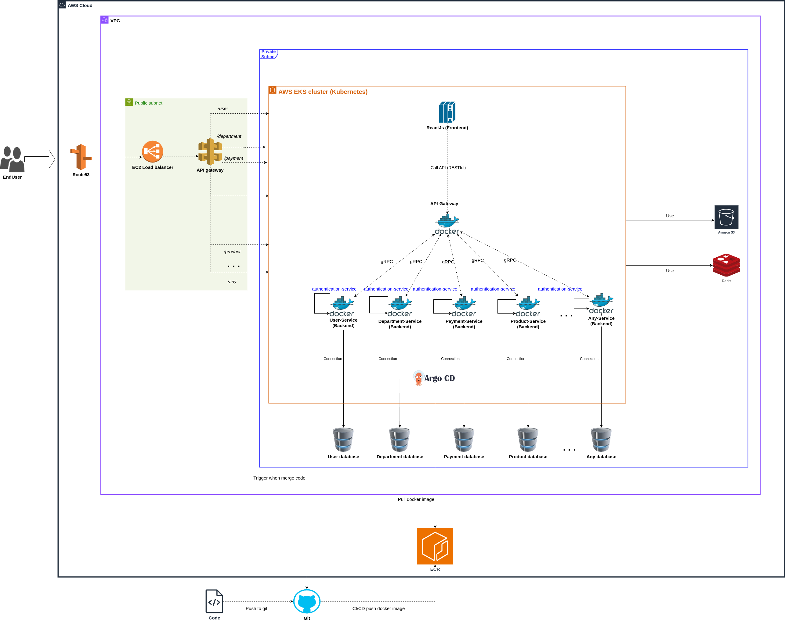

# Microservice architecture (gRPC, K8s, AWS...)


## Repository layout

One Gradle multi-project build (monorepo). Each service is still built and deployed on its own.

```
.
├── settings.gradle            all modules
├── gradle/libs.versions.toml  every dependency version, in one place
├── build-logic/               convention plugins: epl.java-library, epl.proto-library, epl.spring-boot-service, epl.database-service
├── proto/                     .proto contracts -> generated gRPC stubs (com.epl.<service>.v1)
├── libs/
│   ├── grpc-server/           @GrpcServer, server lifecycle (graceful shutdown), interceptor registry, gRPC health
│   ├── database/              PostgreSQL + Flyway + JPA: validate at runtime, migrate in the migrate job, RLS context
│   ├── service-core/          default interceptors (call log + request id, tenant context), GrpcCalls error mapping, paging, proto conversions, test fixtures
│   └── messaging/             Kafka: transactional outbox + relay, idempotent inbox (processed_event), DLT
├── services/                  deployable services (below)
└── database/                  PostgreSQL design, bootstrap script, migration tests (see database/README.md)
```

## Services

| Service | HTTP / gRPC | Schema | Screens | gRPC contract |
|---|---|---|---|---|
| `gateway` | 5555 / — | — | — | REST/JSON edge for every contract (see below) |
| `auth` | 8101 / 9101 | `iam` | `EPL-SY-*` | `epl/auth/v1` |
| `masterdata` | 8102 / 9102 | `md` | `EPL-MD-*` | `epl/masterdata/v1` |
| `inbound` | 8103 / 9103 | `inb` | `EPL-IB-*` | `epl/inbound/v1` |
| `inventory` | 8104 / 9104 | `inv` | `EPL-IV-*` | `epl/inventory/v1` |
| `outbound` | 8105 / 9105 | `outb` | `EPL-OB-*` | `epl/outbound/v1` |
| `billing` | 8106 / 9106 | `bill` | `EPL-BL-*` | `epl/billing/v1` |
| `integration` | 8107 / 9107 | `intg` | `EPL-IT-*` | `epl/integration/v1` |
| `report` | 8108 / 9108 | `rpt` | `EPL-RP-*` | `epl/report/v1` |

Contracts live in `proto/src/main/proto/epl/<service>/v1/`; each RPC is commented with the
screens that call it. The `:proto` module generates the Java messages and stubs once
(`com.epl.<service>.v1`); every service and the gateway use them. Screen codes (`EPL-<domain>-<nnn><channel>`) are listed in
[`docs/screen-codes.md`](docs/screen-codes.md); naming rules for code, proto, DB and events are in
[`docs/naming-conventions.md`](docs/naming-conventions.md). The services expose every RPC already; one that
is not implemented yet answers `UNIMPLEMENTED` naming its screens.

### Service layout and CRUD

Every service with a schema follows the same layers:

```
grpc/<Service>GrpcServer      gRPC endpoint: GrpcCalls.unary(observer, () -> service.method(request))
services/<Aggregate>Service   @Transactional business rules (state checks, version checks, numbering)
repositories/<Table>Repository Spring Data JPA (+ Specification for searches)
entities/<Table>Entity        JPA mapping of the Flyway schema (ddl-auto=validate)
mappers/<Area>Mappers         entity <-> proto message
```

Implemented (CRUD of the main aggregates; business operations such as allocation, inspection or
stocktake confirmation still answer `UNIMPLEMENTED`):

| Service | Implemented |
|---|---|
| `auth` | companies, warehouses, customers, tenants (+ `ResolveTenant`), users (+ password, grants), roles |
| `masterdata` | areas, locations, products (+ barcodes, `ResolveBarcode`), sub-inventories |
| `inventory` | stock search / get, stocktake create / get / list / update / cancel |
| `inbound` | arrivals with lines: create / get / search / update / cancel / delete |
| `outbound` | shipments with lines: create / get / search / update / cancel / delete |
| `billing` | rates with price periods: list / get / upsert / delete |
| `integration` | job definitions, job runs (queue / get / list / delete), purge history |
| `report` | report catalogue (most specific scope wins), printers |

**Request context**: the gateway forwards `x-company`, `x-warehouse`, `x-customer` and `x-user`
(from the verified JWT). `RequestContextServerInterceptor` resolves the codes to ids (auth
`TenantService/ResolveTenant`, cached; `GRPC_AUTH_TARGET`) and every transaction starts with
`set_config('app.tenant_id', …)`, so Row-Level Security applies to all JPA queries. Tenant data needs all
three headers, warehouse data (areas, locations, printers) `x-company` + `x-warehouse`; the tenant registry
and users need none. `created_by` / `updated_by` come from `x-user`.

**Not yet verified by the backends**: they trust `x-user` and the tenant headers as sent (the JWT and the
tenant grants are checked only once `AuthService/Login` / `GetJwks` exist). Until then only the gateway may
reach the gRPC ports (Kubernetes NetworkPolicy).

**gRPC server** (`libs/grpc-server`, `app.grpc.server.*`): every `@GrpcServer` gets the interceptors from
`libs/service-core`: `CallLoggingServerInterceptor` (one log line per call with method, status and duration;
`x-request-id` in the log MDC; an escaped exception becomes a generic `INTERNAL`) and
`RequestContextServerInterceptor`. The server also serves `grpc.health.v1.Health` (Kubernetes `grpc` probes;
`NOT_SERVING` while stopping), `reflection-enabled` (default false) for grpcurl,
`max-inbound-message-size` (4MB) and `shutdown-grace-period` (20s: running calls finish before the pod exits).

**Tests**: each service has `@SpringBootTest` CRUD tests against PostgreSQL 16 (Testcontainers) that call
the real gRPC endpoints in-process with metadata, through all interceptors (`libs/service-core` test
fixtures: `EplTestDatabase`, `GrpcTestServer`).

Services with a schema need PostgreSQL prepared by `database/bootstrap/bootstrap.sql`
(`docker compose up -d postgres` locally). Their migrations are applied by a separate migrate job,
not when the service starts: `./gradlew :services:<service>:bootMigrate` locally, a Kubernetes Job
with `--spring.profiles.active=migrate` in an environment. Run `auth` first on an empty database (the
other schemas reference `iam`). A running service only validates its schema and refuses to start
when a migration is pending. Connection settings: `DB_HOST`, `DB_PORT`, `DB_NAME`,
`DB_USERNAME` / `DB_PASSWORD` (runtime role), `FLYWAY_USERNAME` / `FLYWAY_PASSWORD` (schema owner,
migrate job only). Details in [`database/README.md`](database/README.md#migrations-flyway).

### Events (Kafka)

Every service with a schema uses `libs/messaging` (`docker compose up -d kafka` locally,
`KAFKA_BOOTSTRAP_SERVERS`, default `localhost:9092`):

* **Publish**: `outbox.append(eventType, aggregateType, aggregateId, payload)` inside the business
  transaction writes a row to the schema's `outbox_event`. `OutboxRelay` sends unpublished rows to Kafka
  (topic = event type, key = aggregate id, headers `epl-event-id`, `epl-event-type`, `epl-tenant-id` …) and
  marks them published; a protobuf payload is sent as proto3 JSON. Off in the migrate job and in `report`
  (no outbox); `EPL_OUTBOX_RELAY_ENABLED=false` stops it.
* **Consume**: a `@KafkaListener` hands the record to `inbox.process(consumer, record, handler)`; the event id
  goes into `processed_event` in the handler's transaction (redeliveries are skipped) and the transaction runs
  with the event's tenant, so RLS applies. Failing records are retried, then sent to `<topic>.DLT`.
* Published so far: `inbound.arrival.cancelled` (payload `Arrival`), `user.grants.changed`.

Event flows from the schema design (each service has `outbox_event` and/or `processed_event`; most are not emitted yet):

| Service | Publishes | Consumes |
|---|---|---|
| `auth` | `user.grants.changed`, `policy.changed` | — |
| `masterdata` | master data changes | — |
| `inbound` | `inbound.arrival.*` | outbound returns |
| `inventory` | `stock.*`, `stocktake.*` | inbound / outbound confirmations |
| `outbound` | `outbound.shipment.*` | inventory |
| `billing` | `billing.*` | inbound / outbound / inventory (charge lines, month-end balances) |
| `integration` | `integration.*` | purge / job triggers |
| `report` | — | inventory / outbound (KPI read models) |

Modules depend on each other with `project(':libs:service-core')` etc., so the build no longer
needs Nexus.

## Gateway (REST/JSON edge)

`services/gateway` exposes every RPC of the generated `com.epl.*` stubs over HTTP, so a new
service or RPC in `proto/` needs no gateway code. The backend of an RPC comes from its proto package
(`epl.inventory.v1.StockService` -> `inventory`) and its gRPC target from `epl.gateway.backends`
(`GRPC_<BACKEND>_TARGET`, e.g. `GRPC_INVENTORY_TARGET=dns:///inventory:9104`).

| Request | Meaning |
|---|---|
| `POST /api/rpc/{backend}/{version}/{service}/{method}` | lowercase, words joined by `-` (`epl.masterdata.v1.ProductService/GetProduct` -> `/api/rpc/masterdata/v1/product/get-product`); body = request message in [proto3 JSON](https://protobuf.dev/programming-guides/json/); unary -> JSON, server-streaming -> NDJSON (one message per line) |
| `GET /api/rpc` | every exposed RPC with its path, gRPC method, backend, type and message names |
| `POST /api/files/upload` | multipart `file`, `fileKind`, `validateOnly` -> `UploadService/Upload` (client streaming) |
| `POST /api/reports/render` | `RenderRequest` JSON -> file download from `ReportService/Render` |
| `GET /api/actuator/health` | liveness / readiness |
| `GET /api/swagger-ui.html` | Swagger UI: one operation per RPC with its proto3 JSON schemas (`/api/v3/api-docs`; off with `GATEWAY_API_DOCS_ENABLED=false`) |

```bash
curl -X POST localhost:5555/api/rpc/masterdata/v1/product/get-product \
  -H "Authorization: Bearer $TOKEN" -H "X-Company: C001" -H "X-Warehouse: WH01" -H "X-Customer: CUST01" \
  -H "Content-Type: application/json" -d '{"code":"P001"}'
```

- **Auth**: every path except `epl.gateway.security.public-paths` (Login, Refresh, Logout, GetJwks, health) needs a JWT
  signed by the auth service; keys come from `AuthService/GetJwks` (cached, `JWT_ISSUER` checked when set).
  Backends verify the token again and enforce tenant grants. `GATEWAY_SECURITY_ENABLED=false` turns the check
  off for local development without the auth service.
- **Forwarded as gRPC metadata**: `Authorization`, `X-Company`, `X-Warehouse`, `X-Customer`, `Accept-Language`,
  `X-Request-Id` (generated when missing, echoed in the response).
- **Errors**: gRPC status -> HTTP status (`NOT_FOUND` 404, `INVALID_ARGUMENT` 400, `PERMISSION_DENIED` 403,
  `UNIMPLEMENTED` 501, `UNAVAILABLE` 503 …), body `{"code","message","requestId"}`.

### Sign-in (auth service)

`AuthService/Login` (username, password, `clientId` from `iam.oauth_client`: `PC_WEB`, `HHT`) returns a 15-minute
ES256 access token (claims in [`database/README.md`](database/README.md#2-authentication-jwt)) and a refresh token.
`Refresh` rotates the refresh token; presenting an already used one ends that session (reuse detection).
`Logout` ends one session, or all of them with `allSessions`; so does `UserService/ChangePassword`.
Five wrong passwords lock the account for 15 minutes.

| Variable (auth) | Meaning |
|---|---|
| `JWT_SIGNING_KEY` | EC P-256 private key as a JWK (JSON). Empty = a new key on every start (local only, one instance) |
| `JWT_ISSUER` | `iss` claim (default `epl-auth`); set the same value on the gateway to have it checked |
| `BOOTSTRAP_ADMIN_PASSWORD` | creates user `BOOTSTRAP_ADMIN_USERNAME` (default `admin`) while there is no user; must be changed at first login |

```bash
FLYWAY_PASSWORD=iam_owner DB_PASSWORD=iam_app ./gradlew :services:auth:bootMigrate
DB_PASSWORD=iam_app BOOTSTRAP_ADMIN_PASSWORD='at-least-12-chars' ./gradlew :services:auth:bootRun
./gradlew :services:gateway:bootRun
```

The web client (`epl-frontend` repository) calls the gateway through the Vite dev proxy (`/api` -> `localhost:5555`).

## Build

Requires JDK 21 (the Gradle wrapper downloads Gradle 8.14.5, which cannot run on JDK 25+). The migration tests need Docker.

```bash
./gradlew build                          # everything: compile, test, jars
./gradlew :services:gateway:bootJar      # one service -> services/gateway/build/libs/gateway-*.jar
./gradlew :services:gateway:bootRun      # run one service locally
./gradlew :services:inventory:bootMigrate   # apply one service's migrations, then exit
./gradlew :database:test                 # bootstrap + every migration on PostgreSQL 16 (Testcontainers)
```

### Adding a module

1. Create the folder with a `build.gradle` that applies one convention plugin:
   ```groovy
   plugins { id 'epl.spring-boot-service' }   // or epl.database-service / epl.java-library / epl.proto-library
   dependencies {
       implementation project(':proto')
       implementation project(':libs:grpc-server')
       implementation libs.spring.boot.starter.web
   }
   ```
2. Add it to `settings.gradle` (`include 'services:inventory'`).
3. New third-party versions go into `gradle/libs.versions.toml`, never into a module's `build.gradle`.

## Nexus (optional, Docker images / external artifacts only)

```bash
docker compose up -d
sudo docker exec -it epl-backend-apis-starter-kit-nexus-1 cat /nexus-data/admin.password
```

Nexus URL: http://localhost:8081. Keep its credentials out of the repository
(use `~/.gradle/gradle.properties` or environment variables).
