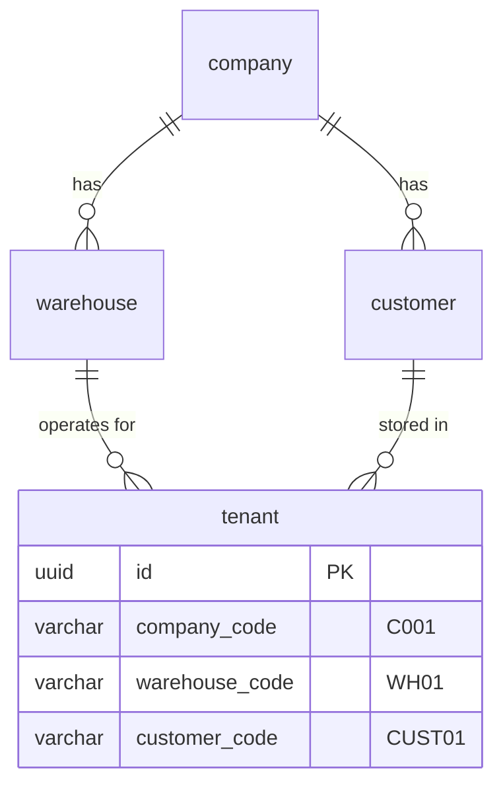
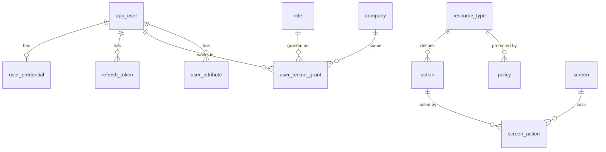
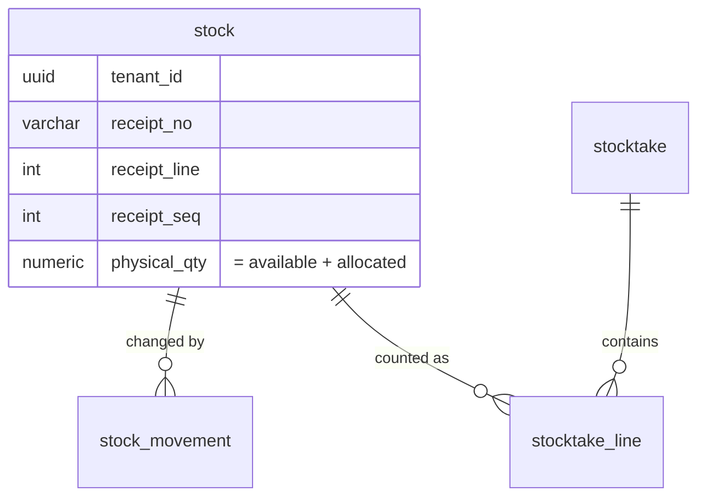
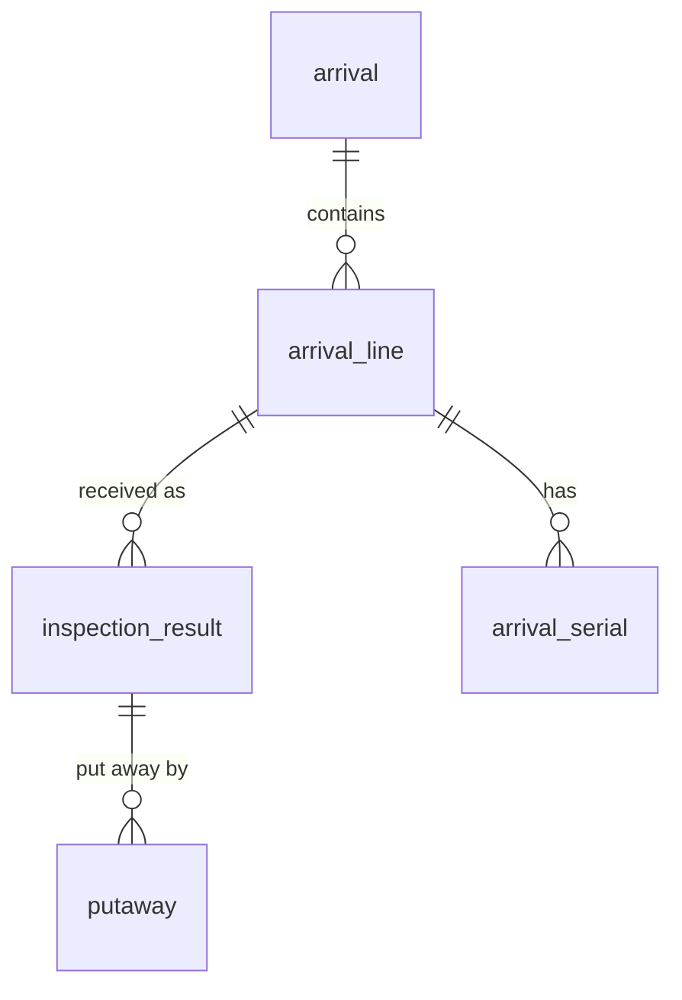
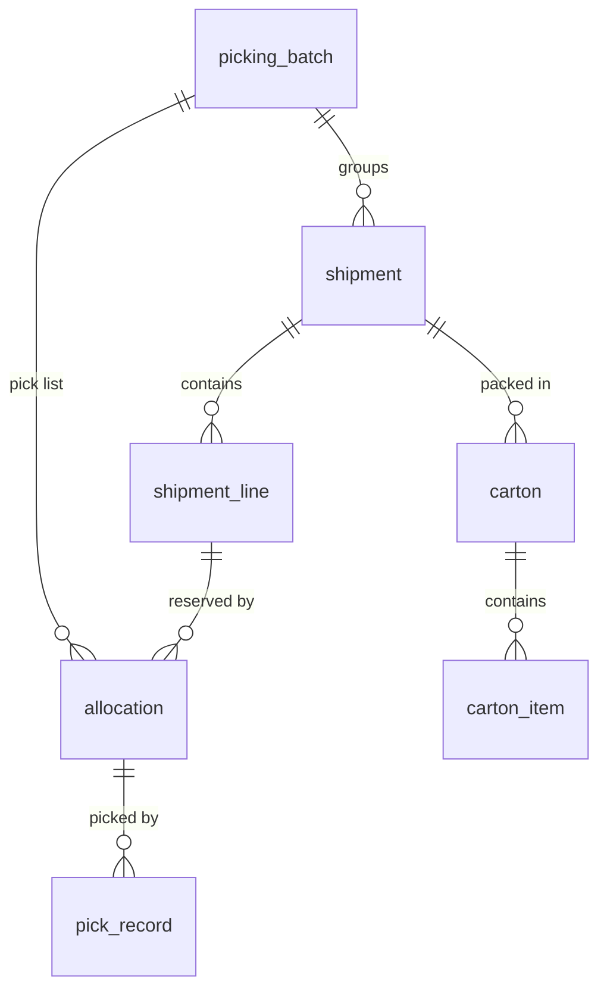
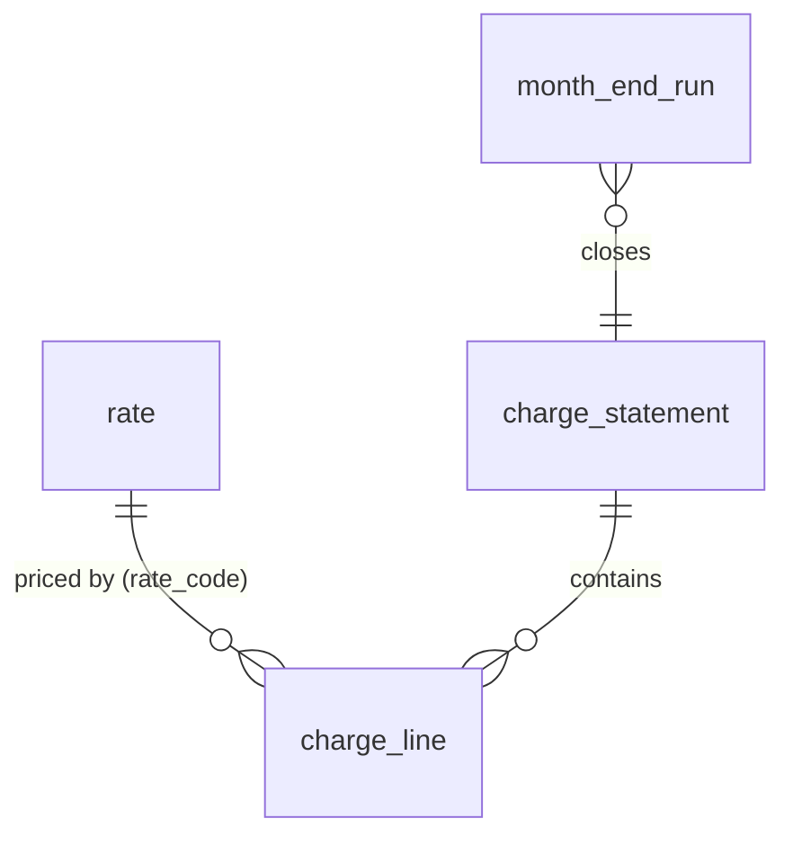

# EPL database design

PostgreSQL 16 schemas for the EPL warehouse management system (gRPC microservices):
identity/permissions, master data, inventory, inbound, outbound, billing, integration and reports.

**One PostgreSQL database `epl`, one schema per service, two roles per service.**

| Schema | Owner service          | Migration role | Runtime role | Migrations (`services/<service>/src/main/resources/db/migration`) |
|--------|------------------------|----------------|--------------|-----------------|
| `app`  | shared (bootstrap)     | superuser      | —            | `database/bootstrap/bootstrap.sql` (roles, schemas, RLS helpers) |
| `iam`  | `services/auth`        | `iam_owner`    | `iam_app`    | `V1..V4` |
| `md`   | `services/masterdata`  | `md_owner`     | `md_app`     | `V1` |
| `inv`  | `services/inventory`   | `inv_owner`    | `inv_app`    | `V1` |
| `inb`  | `services/inbound`     | `inb_owner`    | `inb_app`    | `V1` |
| `outb` | `services/outbound`    | `outb_owner`   | `outb_app`   | `V1` |
| `bill` | `services/billing`     | `bill_owner`   | `bill_app`   | `V1` |
| `intg` | `services/integration` | `intg_owner`   | `intg_app`   | `V1` |
| `rpt`  | `services/report`      | `rpt_owner`    | `rpt_app`    | `V1` |

`epl_admin` (BYPASSRLS) is for config maintenance, reports and data migration across tenants.

`database/` is also a Gradle project: `./gradlew :database:test` runs bootstrap.sql and every
migration on PostgreSQL 16 (Testcontainers), then checks the runtime validation, schema isolation
and RLS. It runs in `./gradlew build` and is skipped when Docker is not available.

### Why one database and not one per service

Ownership is enforced by **privileges instead of separate servers**:

* `<svc>_app` has DML on its own schema only. Reading another service's tables fails with
  `permission denied`, so services still talk to each other through gRPC and Kafka, never SQL.
* The only cross-schema links are **foreign keys to the tenant registry**
  (`iam.company / warehouse / customer / tenant`). `iam/V3` and `iam/V4` grant `REFERENCES` on
  those four tables to the other schema owners, nothing else; FK checks run as the iam table owner.
* Everything else that crosses services (product, location, sub-inventory, transaction kind,
  reason) is a plain code checked over gRPC, with no FK, so stock history doesn't depend on the
  current master data and `md` / `inv` can be deployed and migrated independently.

Benefits: one RDS instance, one backup, one local Postgres for development, no Kafka replication
of tenants, and the database itself guarantees that every row belongs to a real tenant.
To move a service to its own server later, copy its schema and replace its tenant FKs with
a replicated `tenant_ref` table; the service code doesn't change.

## Migrations (Flyway)

### Migrate job, separate from the running service

Migrations are **never applied by the running service**. Each service jar has two modes,
switched by the Spring profile `migrate` (`libs/database`, `epl.database.migration.mode`):

| | Running service (default) | Migrate job (`--spring.profiles.active=migrate`) |
|---|---|---|
| Connects as | `<schema>_app` (`DB_USERNAME` / `DB_PASSWORD`) | `<schema>_owner` (`FLYWAY_USERNAME` / `FLYWAY_PASSWORD`) |
| Flyway | `validate`: refuses to start if a migration is pending, missing or changed | `migrate`, then the process exits (code 0, or 1 on failure) |
| HTTP / gRPC server | started | not started (`web-application-type: none`, `app.grpc.server.enabled: false`) |

So the runtime role never needs DDL rights and the owner password exists only in the job.
Flyway takes a PostgreSQL advisory lock, so two jobs started at once are safe.
The runtime role can read `flyway_schema_history` (bootstrap default privileges) but not change it.

**Order** (on an empty database; later releases just run each service's job before its rollout):

1. `database/bootstrap/bootstrap.sql` as superuser, then set the role passwords from the secret store.
   Idempotent: re-run it when a schema is added.
2. Migrate job of `auth`: it creates the `iam` tables the other schemas reference.
3. Migrate jobs of the other services, in any order.

**Local**

```bash
docker compose up -d postgres                  # bootstrap.sql + dev passwords (password = role name)
FLYWAY_PASSWORD=iam_owner ./gradlew :services:auth:bootMigrate
FLYWAY_PASSWORD=inv_owner ./gradlew :services:inventory:bootMigrate
DB_PASSWORD=inv_app       ./gradlew :services:inventory:bootRun
```

**Kubernetes**: a Job per service and release (or a Helm `pre-install,pre-upgrade` hook), using the
same image as the Deployment:

```yaml
apiVersion: batch/v1
kind: Job
metadata:
  name: inventory-migrate-1-4-0
spec:
  backoffLimit: 2
  template:
    spec:
      restartPolicy: Never
      containers:
        - name: migrate
          image: registry/epl/inventory:1.4.0
          args: ["--spring.profiles.active=migrate"]
          envFrom:
            - secretRef: { name: inventory-db-owner }   # DB_HOST, DB_NAME, FLYWAY_USERNAME, FLYWAY_PASSWORD
```

An init container with the same `args` in the Deployment also works, but it then runs on every pod
start and needs the owner secret in the Deployment; prefer the Job.

### Configuration

Every service that owns a schema applies the `epl.database-service` convention plugin
(adds `libs/database` and the `bootMigrate` task) and has the same block in `application.yml`:

```yaml
spring:
  datasource:                       # runtime: DML only, RLS applies
    url: jdbc:postgresql://${DB_HOST:localhost}:${DB_PORT:5432}/${DB_NAME:epl}
    username: ${DB_USERNAME:inv_app}
  flyway:
    schemas: inv
    default-schema: inv             # history table inv.flyway_schema_history
    create-schemas: false           # schemas come from bootstrap.sql
    locations: classpath:db/migration
    validate-migration-naming: true
---
spring.config.activate.on-profile: migrate
spring:
  main.web-application-type: none
  flyway:
    user: ${FLYWAY_USERNAME:inv_owner}
    connect-retries: 10
app.grpc.server.enabled: false
epl.database.migration.mode: migrate
```

### Writing migrations

* Location: `services/<service>/src/main/resources/db/migration`, only for that service's schema.
* Versioned `V<n>__<description>.sql` (`V5__shipment_add_carrier_service.sql`): sequential integers per
  service, lowercase snake_case description. **A file that has run anywhere is never edited**,
  renamed or deleted; fix it with a new version (validation fails otherwise).
* Repeatable `R__<description>.sql` only for objects that are fully replaced on each change
  (`CREATE OR REPLACE VIEW / FUNCTION`); they re-run whenever their checksum changes.
* Start the file with `SET search_path = <schema>;` and a header comment saying what it is for.
* Every new schema's `V1` grants its app role DML through `ALTER DEFAULT PRIVILEGES` and enables
  `FORCE ROW LEVEL SECURITY` with a policy on every tenant / warehouse table.
* Backward compatible with the version still running (expand → migrate data → contract in a later
  release): add nullable columns or columns with defaults, never rename or drop in the same release
  the code stops using them. Large data changes go in a separate job, not in a migration.
* `CREATE INDEX CONCURRENTLY` on big tables: put it alone in its own file, which Flyway then runs
  outside a transaction.
* No seed data for tenants; reference data the code depends on (job codes, screen catalogue) is fine.
* Run `./gradlew :database:test` before pushing.

## 1. Tenancy model



* `iam.tenant` is the source of truth. `md` and `inv` tables reference it with real FKs;
  `inv.stock`, `inv.stock_movement` and `inv.stocktake` use `(tenant_id, warehouse_id) →
  iam.tenant (id, warehouse_id)`, so a tenant's rows can't be filed under another warehouse.
* Scoped config rows have FKs `(company_id, warehouse_id) → iam.warehouse (company_id, id)` and
  `(company_id, customer_id) → iam.customer (company_id, id)`: a scope can't mix companies.
* Data that the whole warehouse shares (areas, locations) is scoped by `warehouse_id`;
  data that belongs to a shipper (products, stock, stocktakes) by `tenant_id`.
* Configuration rows have nullable `company_id / warehouse_id / customer_id` (`NULL` = `'*'`).

### Row-Level Security at request time

Each service connects as its **non-owner, non-superuser** `<svc>_app` role, and the
tables use `FORCE ROW LEVEL SECURITY`. For each gRPC call the interceptor has already verified
the JWT and the requested tenant; the repository layer then starts the transaction with:

```sql
SET LOCAL app.tenant_id    = '<tenant uuid>';
SET LOCAL app.company_id   = '<company uuid>';
SET LOCAL app.warehouse_id = '<warehouse uuid>';
SET LOCAL app.customer_id  = '<customer uuid>';
```

`SET LOCAL` ends with the transaction, so a pooled connection can't leak one tenant's context
into the next request. Without these settings every policy matches nothing (fail closed).
Admin and batch jobs that need cross-tenant access use a separate `BYPASSRLS` role.

Roles, schemas and the `app.ctx()` / `app.in_scope()` helpers are created by
`bootstrap/bootstrap.sql`. Each schema's V1 sets default privileges so every new table is
granted to its `<svc>_app` role; `inv` additionally revokes `UPDATE`/`DELETE` on the
`stock_movement` ledger.

### Most-specific configuration wins

`specificity = company(1) + warehouse(2) + customer(4)`, so a customer-specific row beats a
warehouse row, which beats a company row, which beats the global default:

```sql
SELECT DISTINCT ON (setting_key) setting_key, value
FROM md.tenant_setting
WHERE app.in_scope(company_id, warehouse_id, customer_id)
ORDER BY setting_key, specificity DESC;          -- = md.effective_tenant_setting
```

The Java `TenantConfigResolver` uses the same rule and caches the result per tenant.

## 2. Authentication: JWT

* `service-authentication` issues a **15-minute access token** (ES256 JWT) and a
  **refresh token** (random 256-bit, only its SHA-256 is stored in `refresh_token`, rotated
  on every use, and the whole family is revoked if an old one is reused).
* Public keys are published as JWKS from `signing_key`; services verify tokens locally.
  Private keys stay in KMS/Vault (`private_key_ref`).
* `app_user.token_version` (`tv` claim) lets you invalidate every token issued to a user at once
  (password change, disable, grant removal).

Access token claims:

```json
{
  "iss": "https://auth.epl.internal",
  "sub": "7c0e…-user-uuid",
  "aud": "epl",
  "exp": 1760000000, "iat": 1759999100, "jti": "…",
  "usr": "jdoe",
  "typ": "INTERNAL",
  "tv": 3,
  "attrs": { "auth_level": 3, "dept": "OPS", "max_adjust_qty": 500 },
  "grants": [
    { "c": "C001", "w": "WH01", "u": "*",      "r": ["WMS_OPERATOR"] },
    { "c": "C001", "w": "WH01", "u": "CUST01", "r": ["WMS_SUPERVISOR"] }
  ]
}
```

* `grants` comes from `user_tenant_grant`; `"*"` = NULL scope column.
* `attrs` = `user_attribute` rows with `in_token = true`.
* The client picks the **active tenant** per call with gRPC metadata
  `x-company`, `x-warehouse`, `x-customer`. The interceptor rejects the call unless one grant
  covers it, then computes the effective roles = union of `r` over the matching grants.
* Users with hundreds of grants: put `"grants_ref": true` in the token and let the interceptor
  fetch and cache the grants from IAM over gRPC.

## 3. Authorization: ABAC

```
gRPC call ─► AuthInterceptor ─► PEP (per method) ─► PDP (library inside each service) ─► allow / deny
             verify JWT,         builds request:        policies cached from iam.policy,
             tenant grant check  subject, resource,     CEL conditions, deny-overrides
                                 action, environment
```

**Request attributes**

| Category    | Examples                                                                                     |
|-------------|----------------------------------------------------------------------------------------------|
| subject     | `id`, `type` (INTERNAL/CUSTOMER/SYSTEM), `roles` (effective for this tenant), `attrs.*`     |
| resource    | `type` (`inventory.stock`), `tenant`, `warehouse`, and type attributes from `resource_type.attributes` (`bonded`, `on_hold`, `qty`, `status` …) |
| action      | `adjust`, `relocate`, `confirm` … (`iam.action`, one per gRPC method)                        |
| environment | `channel` (PC_WEB / HHT / API), `time`, `ip`, `warehouse_local_time`                         |

**Evaluation**

1. Select enabled policies for `resource_type` whose `actions` contain the action or `*`,
   and whose scope matches the active tenant (NULL = any).
2. Evaluate each `condition` with **CEL** (`cel-java`, protobuf-native, side-effect free).
3. Any matching `DENY` → deny. Otherwise any matching `PERMIT` → allow. Otherwise **deny**.
4. Log the decision asynchronously to `iam.authz_decision_log`.

Policies are cached in each service and reloaded when `policy_revision` changes
(announced on Kafka by `policy.changed`).

**Example policies**:

| code                         | effect | scope              | resource / actions                        | condition (CEL) |
|------------------------------|--------|--------------------|-------------------------------------------|-----------------|
| `operator-stock-ops`         | PERMIT | `*`                | `inventory.stock` / read, relocate, change_pick_key, change_sub_inventory, divide | `'WMS_OPERATOR' in subject.roles \|\| 'WMS_SUPERVISOR' in subject.roles` |
| `adjust-within-limit`        | PERMIT | `*`                | `inventory.stock` / adjust                | `'WMS_SUPERVISOR' in subject.roles && resource.qty <= subject.attrs.max_adjust_qty` |
| `no-touch-bonded-from-hht`   | DENY   | `C001/WH01/*`      | `inventory.stock` / adjust, relocate, divide | `resource.bonded && env.channel == 'HHT'` |
| `customer-read-own`          | PERMIT | `*`                | `inventory.stock`, `inventory.movement` / read, export | `subject.type == 'CUSTOMER'` (grant already limits the tenant) |
| `stocktake-confirm`          | PERMIT | `*`                | `inventory.stocktake` / confirm, cancel   | `'WMS_SUPERVISOR' in subject.roles && resource.status == 'COUNTED'` |
| `month-end-office-hours`     | PERMIT | `*`                | `billing.charge` / close_month            | `'WMS_BILLING' in subject.roles && env.warehouse_local_time.getHours() < 20` |

UI button visibility uses the same engine. Every screen has a code `EPL-<domain>-<nnn><channel>`
(`iam.screen`, see `docs/screen-codes.md`); `iam.screen_action` lists the actions it calls.
The client asks `AuthorizationService/BatchCheck` for those actions and hides what is denied.

## 4. Service data models

### IAM



### Inventory



* `stock` keeps the invariant `physical_qty = available_qty + allocated_qty` as a CHECK
  (an adjustment changes physical and available by the same delta).
* `stock_movement` is range-partitioned by `operation_date` (add a partition per month/year).
  A relocation writes a `FROM` leg and a `TO` leg with the same `operation_no`.
* Every stock change = update `stock` + insert `stock_movement` + insert `outbox_event`,
  all in one local transaction.
* Numbering: `number_sequence` row per tenant and code, taken with
  `UPDATE … RETURNING` in the same transaction (the row lock serialises callers).

### Inbound



* An arrival goes `PLANNED → INSPECTING → INSPECTED → CONFIRMED` (or `CANCELLED`).
* Each `inspection_result` becomes one stock lot on confirmation: `receipt_no = arrival_no`,
  `receipt_line = line_no`, `receipt_seq`. Inventory creates the lots from
  `inbound.arrival.confirmed`; inbound never writes to `inv`.
* Supplier details are a jsonb snapshot (`supplier`) next to `supplier_code`, so a document keeps
  what was printed on it even after the party master changes.

### Outbound



* `allocation` = one reserved stock lot (`stock_id` from `inv`, no FK, plus the receipt identity)
  and is also the pick task (`picking_batch_id`, `picking_sequence`). `pick_record` is append-only.
* Line quantities keep `allocated ≤ ordered` and `shipped ≤ allocated` as CHECKs.
* Ship-to, final ship-to, shipper and bill-to are jsonb snapshots, like inbound.

### Billing



* Billing builds everything from events: `charge_line.source_event_id` + `rate_code` is unique,
  so an event delivered twice charges once. Manual lines have no event.
* `rate` is versioned by `valid_from`; a charge line copies the unit price valid on its charge date.
* `month_end_balance` keeps opening / in / out / adjust per product and sub-inventory;
  `closing_qty` is a generated column and the next month's opening.
* Only one `month_end_run` per tenant and month can be `RUNNING` (partial unique index).

### Integration

* `upload` / `upload_error`: metadata and every row error of an upload; the file itself is in
  object storage (`storage_ref`).
* `edi_message`: sent and received messages; `Resend` creates a new row with `resend_of_id`.
* `job_definition` and `purge_rule` are global catalogues (read-only for `intg_app`);
  `job_run` / `purge_history` are per tenant. The purge itself runs in the service that owns the
  table (`purge_rule.service`), triggered by an event, so no service deletes in another schema.

### Report

* `report_definition` / `label_definition` are scoped config resolved most-specific-wins
  (`effective_report_definition`, `effective_label_definition`); read-only for `rpt_app`.
* `printer` / `device_printer` are warehouse-scoped; `print_job` is the history of renders and prints.
* `kpi_daily_stock` is a read model filled from inventory / outbound events (partitioned by date).

## 5. Not designed yet

* Kitting (inventory) and i18n labels/messages.
