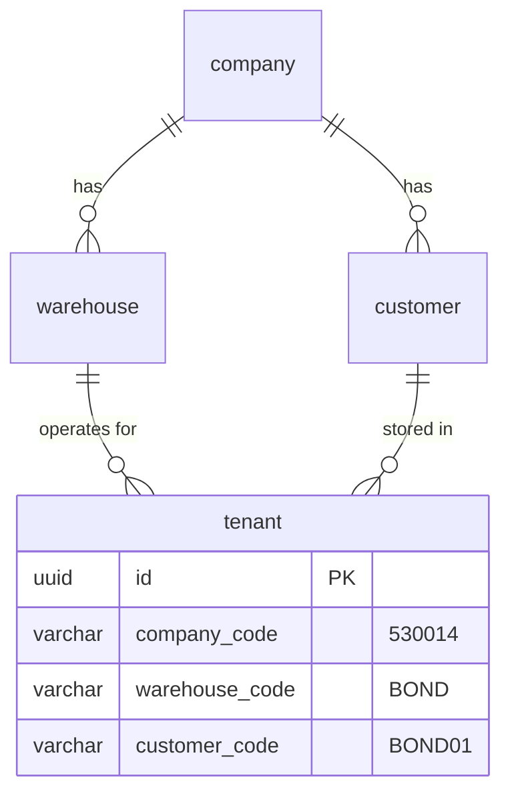
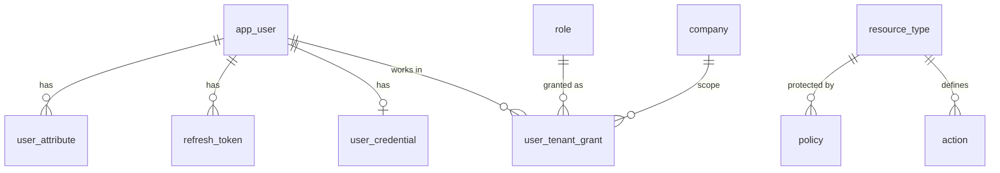
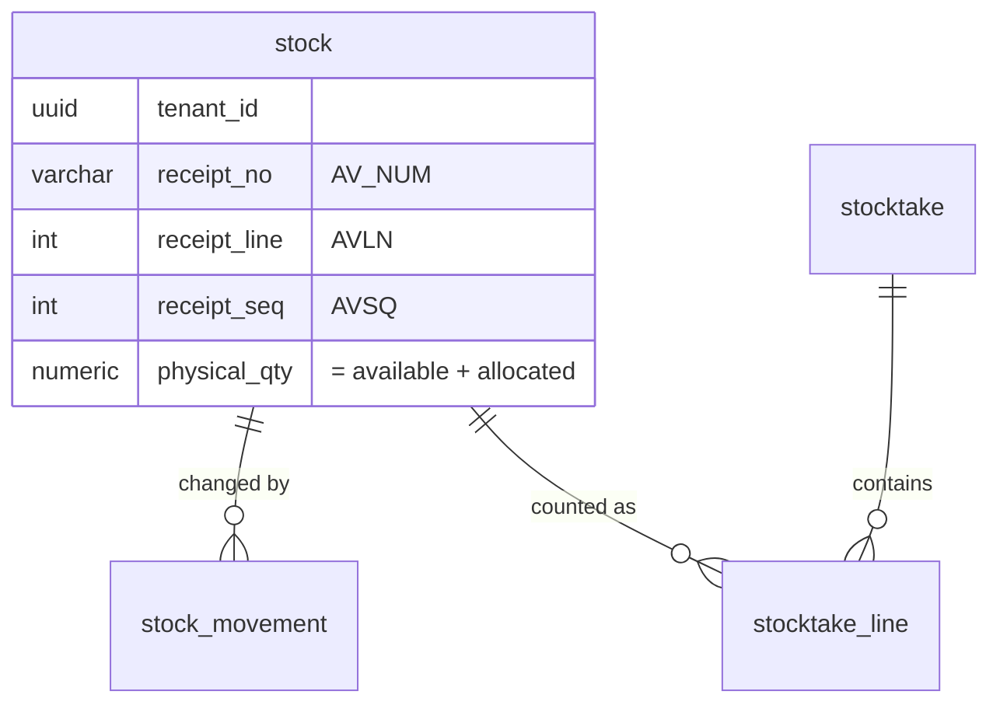

# GWH database design (rebuild of the legacy GWH WMS)

New PostgreSQL 16 schemas for rebuilding the legacy GWH warehouse system
(`logicstic-domain/GWH`, Oracle `SGWH0001` + `SNCU0001`) as gRPC microservices.
First slice: identity/permissions and everything behind `GwhSrvcLpWeb`
(stock, relocation, adjustment, stocktake, serials).

**One PostgreSQL database `epl`, one schema per service, two roles per service.**

| Schema | Owner service            | Migration role | Runtime role | Migration files |
|--------|--------------------------|----------------|--------------|-----------------|
| `app`  | shared (bootstrap)       | superuser      | —            | `bootstrap/bootstrap.sql` (roles, schemas, RLS helpers) |
| `iam`  | `service-authentication` | `iam_owner`    | `iam_app`    | `iam/V1__iam_schema.sql`, `iam/V2__authz_catalog.sql`, `iam/V3__cross_schema_grants.sql` |
| `md`   | `service-masterdata`     | `md_owner`     | `md_app`     | `masterdata/V1__masterdata_schema.sql` |
| `inv`  | `service-inventory`      | `inv_owner`    | `inv_app`    | `inventory/V1__inventory_schema.sql` |

`epl_admin` (BYPASSRLS) is for config maintenance, reports and data migration across tenants.

### Why one database and not one per service

Ownership is enforced by **privileges instead of separate servers**:

* `<svc>_app` has DML on its own schema only. Reading another service's tables fails with
  `permission denied`, so services still talk to each other through gRPC and Kafka, never SQL.
* The only cross-schema links are **foreign keys to the tenant registry**
  (`iam.company / warehouse / customer / tenant`). `iam/V3` grants `REFERENCES` on those four
  tables to `md_owner` and `inv_owner`, nothing else; FK checks run as the iam table owner.
* Everything else that crosses services (product, location, sub-inventory, transaction kind,
  reason) is a plain code checked over gRPC, with no FK, so stock history doesn't depend on the
  current master data and `md` / `inv` can be deployed and migrated independently.

Benefits: one RDS instance, one backup, one local Postgres for development, no Kafka replication
of tenants, and the database itself guarantees that every row belongs to a real tenant.
To move a service to its own server later, copy its schema and replace its tenant FKs with
a replicated `tenant_ref` table; the service code doesn't change.

### Migration order and Flyway

1. `bootstrap/bootstrap.sql` once per environment, as superuser (then set role passwords from the secret store).
2. `iam` (other schemas reference its tables) → 3. `md` → 4. `inv`.

Each service runs its own Flyway on its own schema, with its own history table:

```yaml
spring:
  datasource:            # runtime: DML only, RLS applies
    url: jdbc:postgresql://db:5432/epl
    username: inv_app
  flyway:                # migrations: schema owner
    user: inv_owner
    schemas: inv
    default-schema: inv  # history table inv.flyway_schema_history
    locations: classpath:db/migration
```

## 1. What changed compared to the legacy DB

| Legacy                                                                  | New                                                                                      |
|-------------------------------------------------------------------------|------------------------------------------------------------------------------------------|
| One Oracle schema shared by every module                                | One database, one schema + role pair per service; only tenant-registry FKs cross schemas |
| Tenant = `CPNY_COD‖WHS_COD‖CUST_COD`, repeated in every key             | `tenant` row (company + warehouse + customer) with a UUID; tables store `tenant_id`      |
| Tenant check in PL/SQL (`GWH_PR_PRTTN_010`) with an AES token (hardcoded key) | Signed JWT (ES256, keys in KMS) + gRPC interceptor + PostgreSQL Row-Level Security |
| List partition per tenant (isolation depended on every query's WHERE)   | RLS policies on every tenant table: missing context = zero rows                          |
| `GWH_TM_PEVT` (screen + function key + role group → Y/N)                | ABAC policies: resource + action + CEL condition on subject/resource/environment         |
| `'*'` rows + `ROW_NUMBER() … ORDER BY LENGTH(cpny‖whs‖cust)`            | Nullable scope columns + generated `specificity` + `DISTINCT ON … ORDER BY specificity DESC` |
| `DEL_FLG` + `VGWH_*` views                                               | `deleted_at` on masters only; transactions are never deleted (ledger)                    |
| 8 audit columns (local + UTC time, TZ, terminal, program)                | `created_at/by`, `updated_at/by` (timestamptz) + `version` for optimistic locking         |
| `CIT1..15`, `CFG1..15`, `CNI*` customisation columns                    | `ext jsonb`                                                                              |
| 91 flag columns in `GWH_TM_TRN`, ≈249 in `GWH_TM_CUST`                  | `usages text[]`, `charge_types text[]`, `options jsonb`; `tenant_setting` key/value       |
| `GWH_TJ_TR` + `GWH_TJ_UJ_R` (separate result tables)                    | One append-only `stock_movement` ledger with `movement_type` and FROM/TO legs            |

Kept on purpose: the tenant triple and its codes (`530014 / BOND / BOND01`), the receipt-lot
identity of stock (`AV_NUM / AVLN / AVSQ`), the seven picking keys as real columns (they are
filtered and allocated on constantly), and the business codes (transaction kind, status, reason).

## 2. Tenancy model



* `iam.tenant` is the source of truth. `md` and `inv` tables reference it with real FKs;
  `inv.stock`, `inv.stock_movement` and `inv.stocktake` use `(tenant_id, warehouse_id) →
  iam.tenant (id, warehouse_id)`, so a tenant's rows can't be filed under another warehouse.
* Scoped config rows have FKs `(company_id, warehouse_id) → iam.warehouse (company_id, id)` and
  `(company_id, customer_id) → iam.customer (company_id, id)`: a scope can't mix companies.
* Data that the whole warehouse shares (areas, locations) is scoped by `warehouse_id`;
  data that belongs to a shipper (products, stock, stocktakes) by `tenant_id`.
* Configuration rows have nullable `company_id / warehouse_id / customer_id` (`NULL` = `'*'`).

### Row-Level Security at request time

Each service connects as its **non-owner, non-superuser** `<svc>_app` role, and the
tables use `FORCE ROW LEVEL SECURITY`. For each gRPC call the interceptor has already verified
the JWT and the requested tenant; the repository layer then starts the transaction with:

```sql
SET LOCAL app.tenant_id    = '<tenant uuid>';
SET LOCAL app.company_id   = '<company uuid>';
SET LOCAL app.warehouse_id = '<warehouse uuid>';
SET LOCAL app.customer_id  = '<customer uuid>';
```

`SET LOCAL` ends with the transaction, so a pooled connection can't leak one tenant's context
into the next request. Without these settings every policy matches nothing (fail closed).
Admin and batch jobs that need cross-tenant access use a separate `BYPASSRLS` role.

Roles, schemas and the `app.ctx()` / `app.in_scope()` helpers are created by
`bootstrap/bootstrap.sql`. Each schema's V1 sets default privileges so every new table is
granted to its `<svc>_app` role; `inv` additionally revokes `UPDATE`/`DELETE` on the
`stock_movement` ledger.

### Most-specific configuration wins

`specificity = company(1) + warehouse(2) + customer(4)`, so a customer-specific row beats a
warehouse row, which beats a company row, which beats the global default:

```sql
SELECT DISTINCT ON (setting_key) setting_key, value
FROM md.tenant_setting
WHERE app.in_scope(company_id, warehouse_id, customer_id)
ORDER BY setting_key, specificity DESC;          -- = md.effective_tenant_setting
```

The Java `TenantConfigResolver` uses the same rule and caches the result per tenant.

## 3. Authentication: JWT

* `service-authentication` issues a **15-minute access token** (ES256 JWT) and a
  **refresh token** (random 256-bit, only its SHA-256 is stored in `refresh_token`, rotated
  on every use, and the whole family is revoked if an old one is reused).
* Public keys are published as JWKS from `signing_key`; services verify tokens locally.
  Private keys stay in KMS/Vault (`private_key_ref`).
* `app_user.token_version` (`tv` claim) lets you invalidate every token issued to a user at once
  (password change, disable, grant removal).

Access token claims:

```json
{
  "iss": "https://auth.epl.internal",
  "sub": "7c0e…-user-uuid",
  "aud": "epl",
  "exp": 1760000000, "iat": 1759999100, "jti": "…",
  "usr": "jdoe",
  "typ": "INTERNAL",
  "tv": 3,
  "attrs": { "auth_level": 3, "dept": "OPS", "max_adjust_qty": 500 },
  "grants": [
    { "c": "530014", "w": "BOND", "u": "*",      "r": ["WMS_OPERATOR"] },
    { "c": "530014", "w": "BOND", "u": "BOND01", "r": ["WMS_SUPERVISOR"] }
  ]
}
```

* `grants` comes from `user_tenant_grant` (legacy `GWH_TM_USAH`); `"*"` = NULL scope column.
* `attrs` = `user_attribute` rows with `in_token = true`.
* The client picks the **active tenant** per call with gRPC metadata
  `x-company`, `x-warehouse`, `x-customer`. The interceptor rejects the call unless one grant
  covers it, then computes the effective roles = union of `r` over the matching grants.
* Users with hundreds of grants: put `"grants_ref": true` in the token and let the interceptor
  fetch and cache the grants from IAM over gRPC.

## 4. Authorization: ABAC

```
gRPC call ─► AuthInterceptor ─► PEP (per method) ─► PDP (library inside each service) ─► allow / deny
             verify JWT,         builds request:        policies cached from iam.policy,
             tenant grant check  subject, resource,     CEL conditions, deny-overrides
                                 action, environment
```

**Request attributes**

| Category    | Examples                                                                                     |
|-------------|----------------------------------------------------------------------------------------------|
| subject     | `id`, `type` (INTERNAL/CUSTOMER/SYSTEM), `roles` (effective for this tenant), `attrs.*`     |
| resource    | `type` (`inventory.stock`), `tenant`, `warehouse`, and type attributes from `resource_type.attributes` (`bonded`, `on_hold`, `qty`, `status` …) |
| action      | `adjust`, `relocate`, `confirm` … (`iam.action`, one per gRPC method)                        |
| environment | `channel` (PC_WEB / HHT / API), `time`, `ip`, `warehouse_local_time`                         |

**Evaluation**

1. Select enabled policies for `resource_type` whose `actions` contain the action or `*`,
   and whose scope matches the active tenant (NULL = any).
2. Evaluate each `condition` with **CEL** (`cel-java`, protobuf-native, side-effect free).
3. Any matching `DENY` → deny. Otherwise any matching `PERMIT` → allow. Otherwise **deny**.
4. Log the decision asynchronously to `iam.authz_decision_log`.

Policies are cached in each service and reloaded when `policy_revision` changes
(announced on Kafka by `policy.changed`).

**Example policies** (legacy `GWH_TM_PEVT` / `AUTH_LEVEL` rules rewritten):

| code                         | effect | scope              | resource / actions                        | condition (CEL) |
|------------------------------|--------|--------------------|-------------------------------------------|-----------------|
| `operator-stock-ops`         | PERMIT | `*`                | `inventory.stock` / read, relocate, change_pick_key, change_sub_inventory, divide | `'WMS_OPERATOR' in subject.roles \|\| 'WMS_SUPERVISOR' in subject.roles` |
| `adjust-within-limit`        | PERMIT | `*`                | `inventory.stock` / adjust                | `'WMS_SUPERVISOR' in subject.roles && resource.qty <= subject.attrs.max_adjust_qty` |
| `no-touch-bonded-from-hht`   | DENY   | `530014/BOND/*`    | `inventory.stock` / adjust, relocate, divide | `resource.bonded && env.channel == 'HHT'` |
| `customer-read-own`          | PERMIT | `*`                | `inventory.stock`, `inventory.movement` / read, export | `subject.type == 'CUSTOMER'` (grant already limits the tenant) |
| `stocktake-confirm`          | PERMIT | `*`                | `inventory.stocktake` / confirm, cancel   | `'WMS_SUPERVISOR' in subject.roles && resource.status == 'COUNTED'` |
| `month-end-office-hours`     | PERMIT | `*`                | `billing.charge` / close_month            | `'WMS_BILLING' in subject.roles && env.warehouse_local_time.getHours() < 20` |

UI button visibility (legacy `BTNAUTHMST`) uses the same engine: the client asks
`AuthorizationService/BatchCheck` for the actions on a screen and hides what is denied.

## 5. Service data models

### IAM



### Inventory



* `stock` keeps the invariant `physical_qty = available_qty + allocated_qty` as a CHECK
  (the legacy adjust code changes PYST and AVST by the same delta).
* `stock_movement` is range-partitioned by `operation_date` (add a partition per month/year).
  A relocation writes a `FROM` leg and a `TO` leg with the same `operation_no`.
* Every stock change = update `stock` + insert `stock_movement` + insert `outbox_event`,
  all in one local transaction.
* Numbering: `number_sequence` row per tenant and code, taken with
  `UPDATE … RETURNING` in the same transaction (the row lock serialises callers).

## 6. Legacy → new table map

| Legacy (SGWH0001 / SNCU0001)                       | New                                          |
|----------------------------------------------------|----------------------------------------------|
| TMNCUCMNCPNYMST, GWH_TM_WHS, GWH_TM_CUST (key)     | `iam.company`, `iam.warehouse`, `iam.customer`, `iam.tenant` |
| TMNCUCMNUSERMST, TMNCUEXTUSERMST                   | `iam.app_user` (`user_type`)                 |
| TMNCUEXTPWDMST                                     | `iam.user_credential`, `iam.password_history` |
| GWH_TM_USAH                                        | `iam.user_tenant_grant`                      |
| GWH_TM_PGRP, ROLEGRPMST                            | `iam.role`                                   |
| GWH_TM_PEVT, ROLEAUTHMST, BTNAUTHMST, ACCESSCNTLMST | `iam.resource_type`, `iam.action`, `iam.policy` |
| AGS_PR_TOKEN_010, ENCRYPTDECRYPT                   | JWT + `iam.signing_key`, `iam.refresh_token` |
| GWH_TM_WHS (address, location format)             | `md.warehouse_profile`                       |
| GWH_TM_AREA, GWH_TM_LOC                            | `md.area`, `md.location`                     |
| GWH_TM_PROD, GWH_TM_PBAR                           | `md.product`, `md.product_barcode`           |
| GWH_TM_SBIV                                        | `md.sub_inventory`                           |
| GWH_TM_PIK                                         | `md.picking_key_def`                         |
| GWH_TM_TRN, GWH_TM_STS, GWH_TM_PRCC                | `md.transaction_kind`, `md.status_def`, `md.process_control` |
| GWH_TM_CODE, GWH_TM_RSN                            | `md.code_list` (reasons = kind `REASON`)     |
| GWH_TM_CUST (behaviour flags)                      | `md.tenant_setting`                          |
| GWH_TJ_ST                                          | `inv.stock`                                  |
| GWH_TJ_TR, GWH_TJ_UJ_R                             | `inv.stock_movement`                         |
| GWH_TJ_STK_H, GWH_TJ_STK_D                         | `inv.stocktake`, `inv.stocktake_line`        |
| GWH_TJ_SRL                                         | `inv.serial_number`                          |
| GWH_TM_NUM                                         | `inv.number_sequence` (each service keeps its own) |

## 7. Not designed yet

* **Inbound / outbound** (`AV_H/D/R`, `SP_H/D/R`, picking, packing, delivery), which kitting
  (`lpkte/lpkta/lpkts`) depends on.
* **Billing** (`WSSP/WSPR`, `WMBF/WMBS/WEMB/WEMS`).
* **Integration** (uploads `lpupl`, EDI, GWES re-send), plus i18n labels/messages and printing.
* Data migration from Oracle: map codes → UUIDs through `iam.tenant` (`company_code`,
  `warehouse_code`, `customer_code`) and load per tenant.
